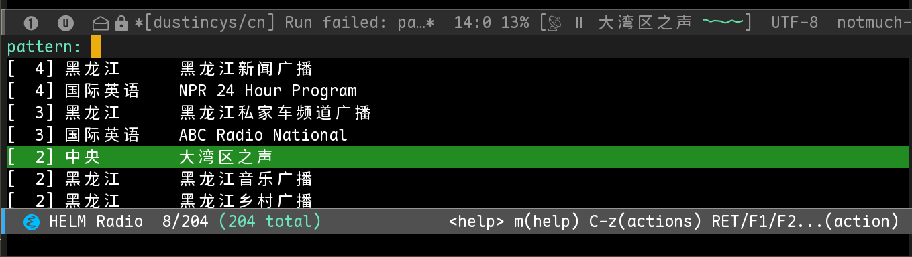

# Emacs Radio v0.4.0 — Real-Audio Miniature SVG Waveform


Requires Emacs 27.1+ / Helm 3+ / mpv (with the `astats` audio filter) and SVG support in a graphical Emacs.

## How It Works

```
Radio URL -> mpv (single playback process) -> audio output device
                       │
                  astats=metadata=1:reset=1
                       │
              af-metadata/radio-meter
                       │
                JSON IPC Unix socket
                       │
           last 12 real RMS dBFS values
                       │
          SVG continuous volume envelope
                       │
            Mode-line: 📻 ▶ station [mini waveform]
```

This is a **real RMS volume envelope curve**, reflecting the loudness of the host and the music; it is not a per-sample PCM voltage waveform, and you cannot reconstruct the sound spectrum from it. No second broadcast stream is opened, and no audio from other applications is captured. mpv's audio buffering can cause the waveform to lag or lead the actual speaker output slightly.

## Installation

1. Dependencies: `sudo apt install mpv ffmpeg python3`, and install Helm inside Emacs.
2. In this ZIP, `emacs-radio.el`, `emacs-radio-waveform.el`, and `emacs-radio-probe.py` **must be in the same installation directory**. The station list can live elsewhere.
3. In your config:

```elisp
(add-to-list 'load-path "~/github/emacs-radio/")
(require 'emacs-radio)
(setq emacs-radio-sources-file "~/github/emacs-radio/radio_sources.tsv"
      emacs-radio-cache-directory "~/.emacs.d/emacs-radio-cache/")
(emacs-radio-mode 1)
```

Before upgrading, quit Emacs or remove the old `.elc`/`.eln` caches so the new `.el` versions are actually loaded. Don't replace just one `.el` file: the new main file depends on the added module.

## Spacemacs Private Layer

`spacemacs-layer/my-radio/packages.el` already adds `emacs-radio-waveform.el` to the GitHub recipe's `:files`. If you already have a `my-radio` layer:

1. First commit the new source files from this ZIP to your `dustincys/emacs-radio` GitHub repository.
2. Then replace `~/.emacs.d/private/my-radio/packages.el` so Quelpa downloads the new waveform module during installation. Or copy the entire `spacemacs-layer/my-radio/` to your private layer path.
3. Update/reinstall the GitHub package and restart Emacs.

Note: if your local package manager only installed the old 3-file recipe, you will see `Cannot open load file: emacs-radio-waveform`.

## Usage

- `M-x emacs-radio-scan`: de-duplicate by URL and detect playable streams (scanning requires FFmpeg).
- `M-x emacs-radio`: search stations with Helm; the list is sorted by usage frequency (descending), with stable ordering for equal frequencies and wrap-around navigation.
- `M-x emacs-radio-toggle-pause`: pause/resume. You can also click the radio status/waveform in the mode line.
- `M-x emacs-radio-stop`: stop mpv, timers, and IPC, and hide the mode-line indicator entirely.
- `M-x emacs-radio-waveform-status`: show the current RMS, time since the last update, IPC status, and failure reason. **Check this command first to determine whether sampling is actually working.**

While playing, a small green waveform is shown; while paused, a horizontal line is shown; when stopped, it is hidden. While connecting, only a flat line may briefly appear.




## Configuration

```elisp
(setq emacs-radio-waveform-enabled t
      emacs-radio-waveform-interval 0.15  ; about 6.7 updates/second
      emacs-radio-waveform-width 42       ; pixels
      emacs-radio-waveform-height 16
      emacs-radio-waveform-color "#65DFA3"
      emacs-radio-waveform-samples 12)
```

To disable the waveform while keeping the radio player, set `emacs-radio-waveform-enabled` to `nil` and select a station again.

The graphical Emacs must have SVG image support; check:

```elisp
(image-type-available-p 'svg)  ; should be t
```

In a pure-terminal Emacs you can still play and switch stations, but the **SVG icon will not be drawn**. If the video stream lacks usable `astats` metadata, the icon stays at the baseline and `M-x emacs-radio-waveform-status` shows the corresponding error.

## FAQ

1. **Waveform not moving**: first check whether `M-x emacs-radio-waveform-status` shows `IPC connected` and a numeric RMS value; then inspect the `*emacs-radio-mpv*` buffer for filter/audio errors.
2. **`Invalid function: helm-build-sync-source`**: the new main file already requires `helm-source` at the top level, but you must clean up old `.elc` files and reinstall the package.
3. **TSV write-back on GitHub may be lost**: this package uses the updated Python script, which by default writes playable stations back to `radio_sources.tsv` and creates a `.bak`. If you don't want the TSV modified in the GitHub package install directory, put the TSV in a user directory or run the script manually with `--no-write-back`.
4. **Verification**: Emacs/mpv were not installed locally, so this delivery has completed structural, Python syntax, and text-level checks, but no end-to-end audio test in an actual Spacemacs + mpv environment.

## Testing

In an environment with Emacs installed (including Helm), run:

```sh
emacs -Q --batch -L . -l tests/emacs-radio-waveform-tests.el -f ert-run-tests-batch-and-exit
```

This project's tests focus on RMS parsing, SVG path generation, and data window updates; real mpv audio and desktop display still require manual local verification.
